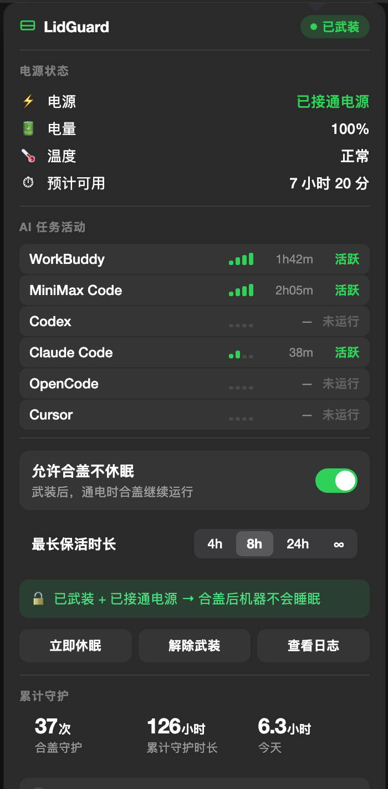

<p align="center">
  
</p>

<p align="center">
  <b>中文</b> ·
  <a href="#english">English</a> ·
  <a href="docs/SAFETY.md">安全模型</a> ·
  <a href="docs/ui-mockup.html">界面设计</a> ·
  <a href="#-顺带打个广告">RUI Media</a>
</p>

# LidGuard · 合盖不休眠

> **macOS 合盖不休眠工具 · macbook lid keep running · 安全封装 `pmset disablesleep`**

合盖离开时让 AI 任务继续跑，**拔电后自动恢复正常休眠**。

只有**接通电源**且**你主动武装过**时，合盖才不会让机器休眠；
一旦拔掉电源、超过时间上限、温度告警或重启，立刻恢复休眠。

---

## 🐈 一个关于猫的故事

做这个工具的起因不是什么宏大的理由。

**是因为家里那只猫。**

那阵子在跑一批 Research 任务 —— 长时间、高负载、机身一直温温的。某天下午我回来看见 MacBook 盖上了，风扇不转了，屏幕黑着。

它把电脑当成取暖器趴了一会儿，顺手把盖子压合上了。三个小时的 Research，没了。

任务可以重跑，但那晚调好的 prompt 调到了两点。

于是我决定：**与其每次都守着，不如让机器自己判断该不该睡。**

这就是 LidGuard 全部的起因。

---



## ⚖️ 它和别的工具不一样在哪

解决「合盖不休眠」的东西大致三类：给一条 `sudo pmset` 命令就完事的、装一个常驻提权 helper 的、顺手帮你「配置」一堆东西的。差别主要在这几点：

| | 常见做法 | LidGuard |
|---|---|---|
| 判定逻辑 | 跑一次命令就不管了 | 每 10 秒复核一次，任何条件不满足立刻还原 |
| 提权方式 | 装常驻 helper，或往 sudoers 写 NOPASSWD 规则 | 守护脚本本身就是 root，**一条 sudoers 规则都不需要** |
| 是否动你的 agent | 有些会往 Claude Code / Codex 的配置里注入 hook | 一个配置文件都不碰 |
| 忘了关会怎样 | 真的睡不了电，直到电池耗尽 | 时间硬上限 + 断电即停 + 重启自动解除 |
| 代价讲不讲清楚 | 很少提「低电量强制休眠已被一起禁用」 | README、界面、文档里都明写这个代价 |
| 判断逻辑在哪 | 散落在脚本和界面各处 | **只有一处**：root 守护脚本，界面没有任何权力改变判定 |
| 能不能验证 | 通常只能靠「合盖试试」 | 11 项判定测试，`pmset` 打桩，插不插电结果一致 |

## 🪡 藏在细节里的心思

做这类工具很容易只做功能，做不到位的是「让人放心」。下面几处我们多花了时间：

**① 界面里没有 CPU 数字。**
一开始想显示 CPU 占用，做出来才发现全是 `0.0%` —— AI agent 大部分时间在等网络返回，CPU 长期接近零。显示一个永远不动的数字，只会让人以为程序坏了。**所以干脆不显示。** 判定改用日志写入时间，CPU 只在后台兜底。

**② 有一个按钮就叫「忘记关掉怎么办？」**
而不是「安全说明」或者「关于」。我们想的是：你半夜合盖走了，第二天才想起来没关。所以这个担心被直接做成了一个按钮，点开就是「最多 4 / 8 / 24 小时，到点自动恢复」「每次开机都会解除」—— **把答案放在问题出现的地方。**

**③ 菜单栏平时是干净的。**
角标只在离开超过 2 分钟之后才显示时长。平时什么都不显示，不占地方、不制造噪音。

**④ 电池供电时，图标是橙色不是绿色。**
绿色 = 现在真的会保活；橙色 = 你武装了，但没插电，插上才会生效。颜色不骗人。

**⑤ 结论条写人话。**
不写 `disablesleep=1`，写「已武装 + 已接通电源 → 合盖后机器不会睡眠」，前面配一把打开的锁；不满足时换成一把打盹的月亮。

**⑥ 时长里有个「∞」。**
但它不是真的无限 —— 拔电照样睡、温度告警照样停、重启照样解除。它只是说「你不设时限」，不是「不管不顾」。

**⑦ 守护脚本里每条命令都写绝对路径。**
`/usr/bin/pmset` 而不是 `pmset`。守护进程跑在 root 下，而 root 的 PATH 不该由任何配置文件决定。

**⑧ 测试是打桩跑的。**
判定逻辑的测试把 `pmset` 换成桩，所以**无论你现在插没插电都得到同样结果** —— 你插着电跑 CI 不会挂，拔了电跑也不会挂。我们自己就栽在过这上面：测试用例原本写死了「插着电」，结果有天拔了电，整套用例全红 —— 查下来是**机器在放电，不是代码坏了**。

**⑨ 卸载是一条命令。**
`sudo ./install.sh --uninstall` 会停服务、删文件，**并且把 `disablesleep` 强制归零**。不用你记得补哪一步。

**⑩ 判定逻辑只有一处。**
界面进程没有任何特权，它写的只是一个「用户希望保持清醒」的标记文件；真正的 `pmset` 调用由 launchd 以 root 身份执行。**判定逻辑不在界面里**，所以界面不可能偷偷改判。

**⑪ 不会开出两个自己。**
开机自启 + 你手欠又点了一次「应用程序」，是两个实例、两个菜单栏图标、两套轮询互相覆盖统计。所以用一把 `flock` 排他锁：拿到锁的才是主实例，拿不到的直接退出并把已在跑的那个叫醒。

**⑫ 电池供电时图标会消失，但面板依然打得开。**
图标藏起来之后不该把入口也藏没了。所以面板的弹出锚点是 App 自建的 1×1 隐形窗口，不依赖菜单栏按钮 —— 从「应用程序」里再点一次 LidGuard，面板就出现在屏幕右上角。

**⑬ Muse 的心跳挑了两轮。**
第一轮选了 analytics 事件库，打开一看事件表是空的（上传完就清）；第二轮选了 `device-v1.json`，前 35 分钟是标准心跳，结果它会自己停摆。最后落在 preferences plist —— 约 30 秒写一次，进程一停就停。**选信号这种事，不实测到底就不知道哪个是真的。**

---

## 为什么需要它

MacBook 无外接显示器时，合盖休眠**无法**被 `caffeinate` 或 `IOPMAssertion` 挡住。唯一有效的开关是：

```bash
sudo pmset disablesleep 1
```

但这个开关有三个危险特性：

1. **它是单一全局标志**，不出现在 `pmset -g cap` 里，无法按电源类型区分。
   所以网上流传的 `pmset -c disablesleep 1`（`-c` = 仅充电时）**根本不起作用**。
2. 它会**一并禁用 macOS 的「电量过低强制休眠」保护**。
3. 它的取值持久化在 `/Library/Preferences/com.apple.PowerManagement.plist`，**跨重启残留**。

第 2、3 条加起来的后果很具体：插着电池、忘了关、合盖进包 —— 机器会一直保持清醒直到电池彻底耗尽。LidGuard 就是来解决这个问题的。

## 核心保证

**任何不确定都倒向「让它睡」。**

```
disablesleep = 1   仅当  已武装 ∧ 接通电源 ∧ 未超时 ∧ 无温度警告 ∧ 本次开机未重启过
disablesleep = 0   其余所有情况
```

| 安全机制 | 说明 |
|---|---|
| 时间硬上限 | 武装最长 4 / 8 / 24 小时，到点自动恢复休眠 |
| 断电即停 | 拔掉电源的下一个轮询周期（10 秒内）立即恢复 |
| 重启自动解除 | 双重判据：`INIT_MARKER` + `kern.boottime` 直接比对，绝不跨重启残留 |
| 温度兜底 | 出现温度警告立即恢复休眠 |
| 超时降级 | 守护进程异常退出后 `disablesleep` 保持为 0 |

## 它不会做什么

- ❌ 不安装、不修改任何 AI agent 的配置
- ❌ 不注入任何 hook、不注册开机自启的第三方 helper
- ❌ 不发起任何网络请求
- ❌ 不改 `pmset disablesleep` 以外的任何电源设置
- ❌ 不需要任何 `sudoers` 规则

## 架构

```
┌──────────────────────────────────────────────┐
│  LidGuard.app   用户级 · 无任何特权             │
│  菜单栏 UI / agent 状态探测 / 守护统计          │
│  只能读写 ~/.lidguard/ 下的标记文件            │
└───────────────────┬──────────────────────────┘
                    │  标记文件
┌───────────────────▼──────────────────────────┐
│  /usr/local/bin/lidguard   root LaunchDaemon  │
│  唯一判定逻辑所在，每 10 秒执行一次             │
│  整机只被一处改动影响：pmset disablesleep      │
└──────────────────────────────────────────────┘
```

## 安装

```bash
git clone https://github.com/ruimedia/lidguard.git
cd lidguard
sudo ./install.sh
```

### 构建菜单栏 App

```bash
cd app
./build-app.sh
open .build/LidGuard.app
```

只需要 Command Line Tools，**不需要完整 Xcode**。

## 使用

1. 插上电源
2. 点菜单栏的 LidGuard 图标，把「合盖不休眠」开关打开
3. 合盖离开

回来时菜单栏图标旁会显示本次离开的时长。

### 菜单栏常驻规则

**接通电源时**图标常驻在菜单栏；**电池供电时**自动隐藏，不占位置。

这条规则是自动的，不需要手动设置。拔掉电源图标会消失，插回电源它自己回来。

图标隐藏时如果想打开面板，从「应用程序」里再点一次 LidGuard 就行（面板会出现在屏幕右上角）。

### 开机自动启动

面板里的「开机自动启动」开关控制它。打开之后，登录系统就会自动运行 LidGuard。

实现上优先用系统的 `SMAppService.mainApp`（注册后会出现在「系统设置 → 通用 → 登录项」里，你可以随时自己关掉）；如果当前这个 App 不是正规签名、注册失败，会自动退回到写一个用户级 `LaunchAgent`，功能一样。

也可以用命令行：

```bash
LidGuard --login on      # 开启
LidGuard --login off     # 关闭
LidGuard --login status  # 查看当前状态
```

| 命令 | 作用 |
|---|---|
| `lidguard on [小时数]` | 武装（默认 8 小时上限） |
| `lidguard off` | 立即解除，并立刻恢复休眠 |
| `lidguard status` | 查看当前判定结果和原因 |
| `lidguard --daemon` | 内部：LaunchDaemon 调用入口 |

### 排障命令

App 自带一个诊断模式，把电源判定、agent 活动、菜单栏规则、登录项状态一次打印出来：

```bash
LidGuard --diagnose
```

输出长这样：

```
=== LidGuard 诊断 ===
电源         : 已接通电源 (AC)
电量         : 100%   温度: 正常
禁睡         : 是
武装         : 已武装
菜单栏图标   : 期望=显示 实际=显示 ✅ 一致
登录项       : 登录后自动启动
--- AI 任务活动 ---
  ● WorkBuddy      活跃  活动文件 0 秒前有写入
  ● Muse           活跃  活动文件 14 秒前有写入
```

还有两个给开发用的开关：

```bash
LidGuard --diagnose --force-battery   # 把电源读数当成电池供电，验证「不通电就隐藏图标」
LidGuard --verify-menubar             # 走完整 GUI 路径，真实测一遍图标显隐
LidGuard --self-test                  # 验证两个二级窗口点击后是否还活着
```

`--verify-menubar` 会依次测两次并给出结论：

```
接电源时（实际读数 AC）菜单栏图标：符合规则 ✅
电池供电时菜单栏图标：已隐藏 ✅
```

## 随时检查与回滚

这两个命令请记住，它们能让你在任何时候确认机器的真实电源状态：

```bash
# 查看系统真实的睡眠禁用状态：No=正常，Yes=休眠被禁
ioreg -r -c IOPMrootDomain | grep SleepDisabled

# 强制回滚，立即恢复正常休眠
sudo pmset -a disablesleep 0
```

## 卸载

```bash
sudo ./install.sh --uninstall
```

## 支持的 AI agent

以下 agent 被纳入活动状态探测（仅用于**界面展示**，不参与保活触发决策）：

| Agent | 活动信号来源 |
|---|---|
| MiniMax Code | `~/.minimax/sessions` 写入时间 |
| WorkBuddy | `~/.workbuddy/logs` 写入时间 |
| Codex | `~/.codex/*.sqlite` 写入时间 |
| Claude Code | `~/.claude/projects` 写入时间 |
| OpenCode | `~/.opencode`、`~/.local/share/opencode` |
| Cursor | `~/Library/Application Support/Cursor/User/workspaceStorage` |
| Muse | `~/Library/Preferences/com.meta.endo.plist` 写入时间 |

判定方式为**日志写入时间 + CPU 活动度**双重信号。

### 关于 Muse 的信号选择

Muse（Meta，bundle id `com.meta.endo`）的信号挑了两轮才挑对。

第一轮候选是 `~/Library/Application Support/com.meta.endo/analytics/unified_micro_batch` —— 一个叫 `FBAnalyticsUnifiedEventStore.sqlite` 的事件库，名字里就写着「analytics event store」。实际打开一看，`analytics_events` 表**长期是 0 行**：事件上传成功后就被清掉了，只剩 WAL 文件偶尔的一次性时间戳。当判据只会得到一个死数字。

第二轮是 `~/Library/Caches/com.meta.endo/AuthRollout/com.meta.endo/device-v1.json`：Muse 进程在跑时**每约 61 秒写一次**，前 35 分钟确实是标准心跳。但实测它会自己停摆 —— 连续 8 分钟不再写入，单独依赖它不可靠。

最终落在 `~/Library/Preferences/com.meta.endo.plist`：Muse 进程在跑时约**每 30 秒写一次**（cfprefsd 代写），进程一停就停，是三个候选里唯一稳定的。所以以它为主判据，device-v1.json 与 analytics 目录作兜底。

## 仓库结构

```
daemon/lidguard         root 守护脚本（判定逻辑唯一所在）
install.sh              安装 / 卸载脚本
tools/test-decision.sh  判定逻辑测试（11 项，pmset 打桩）
tools/probe.swift       无界面的检测核心，可单独编译运行
app/                    AppKit 菜单栏 App（Swift）
  Sources/LidGuard/      9 个源文件
  swiftui-draft/         SwiftUI 版本草稿（见下）
docs/SAFETY.md          安全模型与判定逻辑详解
docs/assets/            图标 SVG 源文件与生成脚本
docs/ui-mockup.html     界面设计稿（深浅双色，浏览器直接打开）
```

### 跑测试

```bash
sh tools/test-decision.sh
```

测试会把守护脚本里的 `pmset` 替换成桩程序，因此**无论机器当前插没插电都得到同样结果**，可以在 CI 里跑。它只改动 `~/.lidguard/armed`，测完自动还原原状态。

其中一项是**静态路径检查**：脚本里出现的每个绝对路径都必须真实存在。这不是多余的 —— `touch` 在 macOS 是 `/usr/bin/touch`，写成 `/bin/touch` 配上 `2>/dev/null`，会每 10 秒静默失败一次而没人发现。

### 为什么界面用 AppKit 而不是 SwiftUI

`@State` / `@StateObject` 依赖 `SwiftUIMacros` 插件，该插件**随完整 Xcode 分发**，在只安装了 Command Line Tools 的机器上无法编译。为了让项目在没有 Xcode 的机器上也能构建，界面改用纯 AppKit 实现。

`app/swiftui-draft/` 保留了等价的 SwiftUI 版本，装了 Xcode 后可直接迁回。

## 系统要求

- macOS 13 或更高（Apple Silicon 与 Intel 均可）
- root 权限仅用于安装 LaunchDaemon，App 本身运行在用户级

## 已知局限

诚实列出，详见 [docs/SAFETY.md](docs/SAFETY.md)：

- `disablesleep` 会禁用低电量强制休眠，这是该开关的固有行为，无法只关闭其中一项
- Apple Silicon 不支持 Wi-Fi 唤醒；本机无启用有线网口，**真正的远程唤醒做不到**
  （保持清醒 ≠ 可远程唤醒）
- 若守护进程在 `disablesleep=1` 期间崩溃，该值会持续到下次手动纠正；
  8 小时硬上限把最坏情况限制在 8 小时内

### macOS 27 上菜单栏图标不出现（系统级问题）

在 **macOS 27.0.1 (26A434)** 上实测：`NSStatusItem` 创建成功、`button` 非空、
MenuBarAgent 日志里场景已注册且事件转发成功，但**屏幕上就是没有图标**。

这不是 LidGuard 的代码问题。已逐项排除：

| 怀疑 | 实测结果 |
|---|---|
| `LSUIElement=true` 导致 | 改成 `false`（有 Dock 图标）一样不显示 |
| 激活策略 `.accessory` 导致 | 保持 `.regular` 一样不显示 |
| 状态项创建时机导致 | `applicationWillFinishLaunching` / `run()` 之前 / 延迟创建，三种都不显示 |
| `autosaveName` 被标记为已移除 | 换全新 `autosaveName` 不显示 |
| 代码签名不够正规 | `TAG.app` 同样是 ad-hoc 签名，它的图标正常显示 |
| 最小复现 | 10 行代码的最小 App 同样不显示 |

已排除的方法：重启 `MenuBarAgent`（`killall MenuBarAgent`）不能解决，
反而可能让整个菜单栏短暂消失。

**目前有效的解法是注销重登或重启**，让状态项在登录序列里创建。
打开「开机自动启动」后，登录时它会随系统一起启动，图标通常就正常了。

作为兜底，即使菜单栏没有图标，面板依然打得开：
从「应用程序」里再点一次 LidGuard，面板会出现在屏幕右上角。
（面板的弹出锚点是 App 自建的一个 1×1 隐形窗口，不依赖菜单栏按钮。）

### 电源状态判定用的是 `pmset -g ps`

Apple Silicon 上 `IOPSCopyPowerSourcesList` 只返回 `InternalBattery`，
AC 适配器根本不在列表里，判不出「有没有插电」。所以电源来源改用
`pmset -g ps` 判断 `'AC Power'`，已与 `pmset` 输出交叉验证一致。

---
---

# English

<p align="center">
  
</p>

**LidGuard** is a macOS menu bar tool that keeps your Mac awake while the lid is closed,
and restores normal sleep the moment you unplug.

There is exactly one mechanism on macOS that survives a closed lid without an external
display: `pmset disablesleep`. That switch is dangerous — it also disables the
low-battery forced-sleep protection, it persists across reboots, and it is a single
global flag that **cannot** be scoped to AC power (`pmset -c disablesleep` does not work).

LidGuard wraps that one switch with a single rule:

```
disablesleep = 1   only if  armed ∧ on AC power ∧ within time budget ∧ no thermal warning ∧ not from a previous boot
disablesleep = 0   everything else
```

Any uncertainty resolves to *let it sleep*.

### 🐈 Why this exists

The reason isn't especially grand. **It's because of a cat.**

I was running a batch of research jobs — long-running, heavy, keeping the machine warm.
I came back one afternoon to find the lid closed, the fans silent, the screen dark.

It had been using the laptop as a heater, and in the process closed the lid. Three hours
of research, gone. The job could be re-run, but the prompt I'd been tuning until 2am
was not something I wanted to redo.

So the decision was: **instead of babysitting it, let the machine decide whether it
should sleep.** That's the entire origin of LidGuard.

### ⚖️ How it differs from other tools

| | Common approach | LidGuard |
|---|---|---|
| Decision logic | Run a command once, never look again | Re-checks every 10 seconds, restores the moment any condition fails |
| Privilege model | A resident helper, or a NOPASSWD sudoers rule | The daemon *is* root — **zero sudoers rules** |
| Touches your agents | Some inject hooks into Claude Code / Codex configs | Not a single config file is modified |
| If you forget to turn it off | The machine stays awake until the battery dies | Hard time cap + dies on unplug + disarms on reboot |
| Is the cost explained | Rarely mentions that low-battery sleep is disabled too | Stated in the README, the UI, and the docs |
| Where the logic lives | Scattered across scripts and UI | **One place only**: the root daemon. The UI cannot alter the verdict |
| Can you verify it | Usually "close the lid and see" | 11 decision tests with `pmset` stubbed — same result plugged in or out |

### 🪡 The small touches

**No CPU number in the UI.** We wanted to show CPU load, but it was always `0.0%` —
AI agents spend most of their time waiting on network responses. A number that never
moves just makes people think the app is broken. **So we left it out.** Detection uses
log write time instead, with CPU only as a background fallback.

**One button is literally named "What if I forget to turn it off?"** Not "Safety" or
"About". We were thinking: you close the lid and leave at night, and the next morning
you realise you never switched it off. So that worry became a button, and clicking it
shows you the time cap and the reboot behaviour. **The answer lives where the question
does.**

**The menu bar stays clean.** The badge only appears after you've been away for more
than two minutes.

**Orange, not green, when you're on battery.** Green means it's actually keeping the
machine awake right now. Orange means you're armed but not plugged in — plug in and it
takes effect. The colour doesn't lie.

**The verdict reads like a sentence.** Not `disablesleep=1`, but "Armed + on AC power →
the machine will stay awake", with an open padlock in front. When it doesn't hold, you
get a sleepy moon instead.

**The duration picker includes "∞".** But it isn't really infinite — unplug and it
sleeps, a thermal warning stops it, a reboot disarms it. It only means "I won't set a
limit", not "don't care".

**Every command in the daemon uses an absolute path.** `/usr/bin/pmset`, not `pmset`.
The daemon runs as root, and root's PATH shouldn't be up to some config file.

**The tests are stubbed.** The decision tests swap `pmset` for a stub, so **you get the
same result whether your laptop is plugged in or not** — CI doesn't care which. We got
this wrong ourselves: our test assumed AC power, and one day we unplugged, and the
whole suite went red. The machine was on battery; the code was fine.

**Uninstall is one command.** `sudo ./install.sh --uninstall` stops the service, removes
the files, **and forces `disablesleep` back to 0**. You don't have to remember a step.

**The decision logic exists in exactly one place.** The UI process has no privileges at
all — it writes a marker file saying "the user wants to stay awake". The actual
`pmset` call is made by launchd as root. **The verdict isn't in the UI**, so the UI
can't quietly change it.

**It never opens two of itself.** A login item plus an impatient double-click on
Applications means two instances, two menu bar icons, and two polling loops fighting
over the same stats file. An exclusive `flock` settles it: whoever holds the lock is
the main instance, the other exits and wakes the one already running.

**The icon disappears on battery, but the panel stays reachable.** Hiding the icon
shouldn't hide the way in. The panel anchors to a 1×1 invisible window the app creates
itself, not to the menu bar button — click LidGuard again in Applications and the panel
appears in the top-right corner.

**Muse's heartbeat took two attempts.** First we picked the analytics event store, then
opened it and found the events table empty (they're deleted after upload). Then we
picked `device-v1.json`, a proper 61-second heartbeat — until it stopped on its own.
What actually held up was the preferences plist: written roughly every 30 seconds, and
it stops the moment the process does. **You don't know which signal is real until you
watch it for a while.**

### Install

```bash
git clone https://github.com/ruimedia/lidguard.git
cd lidguard
sudo ./install.sh
cd app && ./build-app.sh && open .build/LidGuard.app
```

### Use

1. Plug in the power adapter
2. Click the LidGuard icon in the menu bar and switch on "Allow lid-closed no-sleep"
3. Close the lid and leave

When you come back, the menu bar shows how long you were gone.

#### When the menu bar icon shows

The icon **stays in the menu bar while you're on AC power** and **disappears when you're
on battery** — no configuration needed. Unplug and it goes; plug back in and it returns.

If the icon is hidden and you still want the panel, click LidGuard again in
Applications — the panel appears in the top-right corner of the screen.

#### Launch at login

The "Launch at login" switch in the panel controls it. Once on, LidGuard starts
automatically when you log in.

Under the hood it prefers Apple's `SMAppService.mainApp` (the entry then shows up under
System Settings → General → Login Items, where you can switch it off yourself). If the
app isn't properly signed and that registration fails, it falls back to writing a
user-level `LaunchAgent` — same behaviour, different place to look.

```bash
LidGuard --login on      # enable
LidGuard --login off     # disable
LidGuard --login status  # show current state
```

| Command | What it does |
|---|---|
| `lidguard on [hours]` | Arm it (default 8-hour cap) |
| `lidguard off` | Disarm and restore sleep immediately |
| `lidguard status` | Show the current verdict and why |

#### Troubleshooting

```bash
LidGuard --diagnose
```

Prints the power verdict, agent activity, the menu bar rule and the login item state in
one go:

```
=== LidGuard 诊断 ===
电源         : 已接通电源 (AC)
禁睡         : 是
武装         : 已武装
菜单栏图标   : 期望=显示 实际=显示 ✅ 一致
登录项       : 登录后自动启动
--- AI 任务活动 ---
  ● WorkBuddy      活跃  活动文件 0 秒前有写入
  ● Muse           活跃  活动文件 14 秒前有写入
```

Two developer switches are included as well:

```bash
LidGuard --diagnose --force-battery   # pretend you're on battery, to check the hide rule
LidGuard --verify-menubar             # walk the full GUI path and really toggle the icon
LidGuard --self-test                  # check that the two secondary windows survive a click
```

`--verify-menubar` measures twice and reports the verdict:

```
接电源时（实际读数 AC）菜单栏图标：符合规则 ✅
电池供电时菜单栏图标：已隐藏 ✅
```

### Verify and roll back at any time

```bash
ioreg -r -c IOPMrootDomain | grep SleepDisabled   # No=normal, Yes=sleep disabled
sudo pmset -a disablesleep 0                       # force rollback
```

### Uninstall

```bash
sudo ./install.sh --uninstall
```

### Known limitations

- `disablesleep` also disables the low-battery forced-sleep protection. That's inherent
  to the switch; you can't turn off just one half of it.
- Apple Silicon doesn't support Wake on LAN over Wi-Fi, and with no wired port enabled
  there's no way to actually wake the machine from sleep remotely. Staying awake is not
  the same as being remotely wakeable.
- If the daemon crashes while `disablesleep=1`, the value persists until someone
  corrects it. The 8-hour cap bounds that window.

#### On macOS 27 the menu bar icon may not appear (system-level issue)

Measured on **macOS 27.0.1 (26A434)**: the `NSStatusItem` is created successfully, the
button is not nil, MenuBarAgent logs the scene registration and forwards events — and
yet **nothing shows up on screen**.

This is not a LidGuard bug. Each candidate cause was ruled out by testing:

| Suspect | Result |
|---|---|
| `LSUIElement=true` | `false` (with a Dock icon) doesn't show it either |
| `.accessory` activation policy | `.regular` doesn't show it either |
| When the item is created | before `run()`, in `applicationWillFinishLaunching`, or delayed — none work |
| `autosaveName` remembered as removed | a brand-new `autosaveName` doesn't show it either |
| Not formally signed | `TAG.app` is ad-hoc signed too, and its icon renders fine |
| Something specific to our app | a 10-line minimal App doesn't show it either |

Restarting `MenuBarAgent` (`killall MenuBarAgent`) does **not** help, and can briefly
take the whole menu bar away.

**Logging out and back in (or rebooting) does help** — the item then gets created during
the login sequence. Turning on "Launch at login" means it starts with the system, and
the icon normally shows up from then on.

As a fallback the panel still opens even with no menu bar icon: click LidGuard again in
Applications and it appears in the top-right corner. (The panel anchors to a 1×1
invisible window the app creates itself, not to the menu bar button.)

---
---

## 📣 顺带打个广告

我们是 **RUI Media CO., LIMITED ／ 香港奢华品牌传播有限公司** —— 一间面向奢华酒店、旅游目的地与高端生活方式品牌的**传播与内容运营公司**。

我们做的事很具体：品牌定位、公关与媒体关系、编辑内容、社交媒体、视觉表达，围绕品牌资料、内容规范、编辑审核和客户反馈，把项目从头跑到尾。我们也在推进 **RUIDITOR** —— 把这些散落的知识、规则和反馈接进一条更清楚的工作流里。

我们相信一件事：**内容的好坏不取决于写了多少，而取决于有没有把话说准。** 所以我们坚持每一条关键事实都找得到来源，每一次修改都留得下原因，每一次发布都有明确的负责人。不用未经验证的「准确率」或者「省了多少工时」当承诺 —— 那些数字经不起追问。

如果你的品牌也在意内容质量，而不只是内容数量，**欢迎来找我们聊聊**。

- 官网：[rui.media](https://www.rui.media/zh/)
- 博客：[rui.media/blog](https://www.rui.media/blog/)
- GitHub 组织：[@ruimedia](https://github.com/ruimedia)
- 或在 LinkedIn 上找我们：[hehaorui](https://www.linkedin.com/in/hehaorui)

### 也欢迎你参与 LidGuard

LidGuard 是我们自己的工具。公开出来，是因为**同一条命令的代价，值得让更多人看见** —— `pmset disablesleep` 是个很少有人讲清楚后果的开关。

- **发现 bug** → 开 Issue，附上复现步骤，我们很欢迎
- **想要功能** → 开 Issue 聊聊，你的使用场景可能是我们没想到的
- **想改代码** → 直接提 PR。代码保留所有权利（见 [LICENSE](LICENSE)），但贡献内容的使用授权我们会在每个 PR 里单独确认 —— 我们认真看每一个
- **觉得哪句话写得不对** → 哪怕只是一句吐槽，也请告诉我们

留言吧。🐈

## 许可 / License

**保留所有权利。** 本仓库公开仅供阅读与安全研究，未授予任何复制、修改、分发或商业使用的许可。详见 [LICENSE](LICENSE)。
